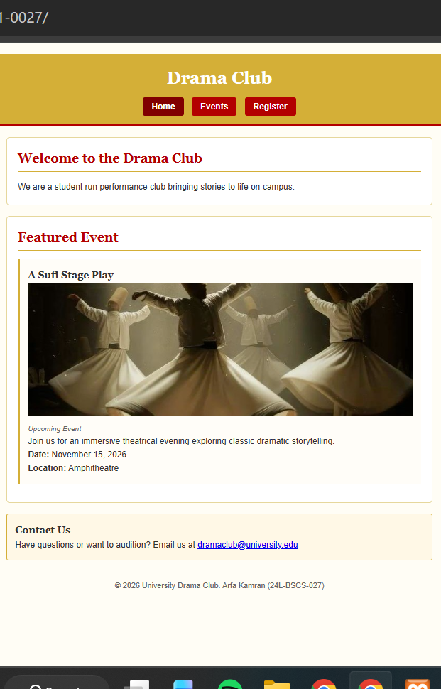

# University Drama Club

## About the Club
The Drama Club is a vibrant student-led university club dedicated to performing arts, theatrical plays, and creative storytelling.

## Pages Included
- **`index.html` (Home Page):** Features an introduction to the society, highlights our primary upcoming Sufi play, and provides committee contact information with social links.
- **`events.html` (Events Page):** Displays a structured schedule of four upcoming events, complete with titles, dates, locations, and descriptive overviews.
- **`register.html` (Register Page):** Contains an accessible registration form with client-side validation, integrated with `localStorage` to save, display, and manage registrations directly in the browser.

## How to Open the Site Locally
1. Download or clone this repository to your local computer:
   ```bash
   git clone [https://github.com/arfakamranbutt/cit331-assignment1-0027.git](https://github.com/arfakamranbutt/cit331-assignment1-0027.git)
2. Navigate into the repository folder:
   Bash
   cd cit331-assignment1-0027
3. Open the index.html file in any modern web browser (Google Chrome, Microsoft Edge, etc).

## Live Published Website
GitHub Pages: https://arfakamranbutt.github.io/cit331-assignment1-0027/

## Homepage Preview

